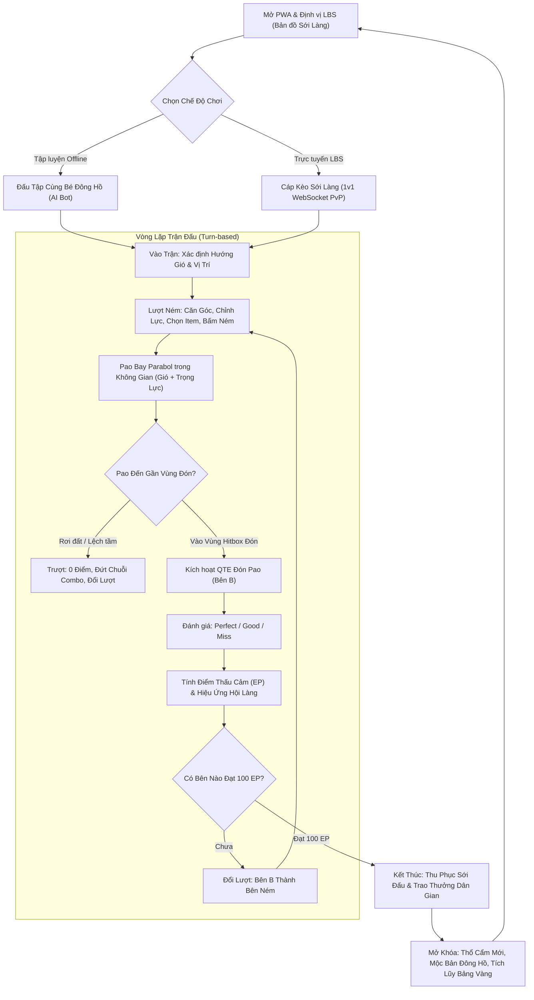

# TÀI LIỆU ĐẶC TẢ SẢN PHẨM (PRD)
## DỰ ÁN: PAO VERSION 0.1 – SỚI PAO DÂN GIAN
### Web Game PWA Đối Kháng Tọa Độ & Gắn Kết Văn Hóa Dân Gian Việt Nam

---

## 1. TỔNG QUAN DỰ ÁN & TẦM NHÌN (EXECUTIVE SUMMARY)

### 1.1. Tên dự án
- **Tên chính thức:** Pao (Phiên bản 0.1 - Sới Pao Dân Gian / Folk Pao Arena)
- **Định dạng:** Web Progressive Web App (PWA), ưu tiên di động màn hình ngang (Mobile Landscape).

### 1.2. Định vị sản phẩm
"Pao" là tựa game web đối kháng tọa độ 2D mang tính văn hóa và phi bạo lực, kết hợp giữa 3 trụ cột:
1. **Cơ chế căn góc - chỉnh lực - tính gió:** Kế thừa sự hấp dẫn, tính toán quỹ đạo parabol kinh điển của dòng game bắn tọa độ (*Gunny, Worms*).
2. **Cơ chế Thấu Cảm Phi Bạo Lực (Non-violent Empathy):** Chuyển hóa khái niệm "bắn hạ đối thủ / trừ máu (HP)" thành "ném pao kết duyên / gia tăng thấu cảm". Điểm Thấu Cảm (Empathy Points - EP) tăng lên khi cả hai bên ném chuẩn và đón dính pao.
3. **Mỹ học Tranh Mộc Bản Đông Hồ & Văn hóa Dân gian:** Toàn bộ phong cách thị giác tái hiện chất mộc bản khắc gỗ dân gian Đông Hồ (nét viền đen mộc, mảng màu ngũ sắc tự nhiên: son, chàm, điệp, vàng hòe trên nền giấy điệp ánh kim), hòa quyện cùng phong tục ném pao ngày hội xuân vùng cao Tây Bắc.
4. **Định vị Sới Làng Ngoài Đời Thực (LBS - Location-Based Service):** Người chơi có thể dùng GPS để quét các "Sới Làng" thực tế quanh khu vực sinh sống (công viên, đình làng, hồ nước) hoặc "Du Hành Tâm Tưởng" đến các danh thắng nổi tiếng.

---

## 2. TRIẾT LÝ GAMEPLAY: CƠ CHẾ THẤU CẢM (EMPATHY SYSTEM)

### 2.1. Bản chất văn hóa của trò chơi Ném Pao
Trong văn hóa truyền thống của đồng bào H'Mông, trò ném pao (ném quả cầu vải lanh nhiều màu) trong dịp Tết không phải là hành vi tấn công hay đối đầu triệt hạ, mà là nghi thức giao duyên, thử tài khéo léo, trao gửi tâm ý giữa các chàng trai và cô gái. Nếu người ném khéo và người đón tài tình, quả pao không rơi xuống đất, tình cảm và sự thấu hiểu giữa đôi bên sẽ ngày càng sâu sắc.

### 2.2. Quy tắc Thấu Cảm (Empathy Points - EP)
- **Không có thanh Máu (HP):** Không có sát thương, không có cháy nổ hay bạo lực thể chất.
- **Thanh Thấu Cảm (0 -> 100 EP):** Mỗi bên bắt đầu trận đấu với 0 điểm Thấu Cảm.
- **Nguyên lý Tích Lũy Điểm:**
  - Điểm Thấu Cảm tăng lên dựa trên sự phối hợp: Bên A ném chính xác vào vùng đón của Bên B + Bên B thực hiện cú bắt chuẩn xác (Quick Time Event - QTE).
  - Cả hai bên đều được cộng điểm khi quả pao được đón thành công, tuy nhiên **bên thực hiện thao tác xuất sắc hơn trong lượt sẽ nhận nhiều điểm hơn**.
- **Điều kiện Chiến Thắng (Thu Phục / Kết Duyên):**
  - Bên nào chạm mốc **100 EP trước** sẽ giành chiến thắng (Danh hiệu: "Tâm Đầu Ý Hợp" / "Thu Phục Sới Làng").
  - Nếu sau 10 lượt ném mỗi bên chưa ai đạt 100 EP, bên có điểm Thấu Cảm cao hơn sẽ thắng. Nếu bằng điểm, kết quả là "Hòa Duyên".

---

## 3. VÒNG LẶP TRẢI NGHIỆM NGƯỜI CHƠI (CORE GAMEPLAY LOOP)

---

## 4. CƠ CHẾ CHI TIẾT TRONG TRẬN ĐẤU (MATCH MECHANICS)

### 4.1. Cơ chế Lượt Ném (Thrower's Mechanics)
Mỗi lượt ném có giới hạn thời gian **15 giây** (Turn Timer).
1. **Căn Góc ($\alpha$):**
   - Thước đo góc rẻ quạt phong cách mây cuộn Đông Hồ (0° đến 90°).
   - Điều khiển bằng thanh trượt hoặc 2 nút tăng giảm góc (+ / -).
2. **Đo Lực ($v_0$):**
   - Thanh đo lực (Power Gauge) dạng mộc bản khắc gỗ từ 0% đến 100%.
   - Người chơi giữ nút **NÉM** để tích lực, nhả tay tại điểm mong muốn (hoặc chạm/kéo trên thanh lực).
3. **Yếu tố Môi trường - Trận Gió ($W$):**
   - Hướng gió: Thuận chiều (thổi sang đối thủ) hoặc Nghịch chiều (thổi ngược lại).
   - Cường độ gió: Hiển thị từ 0.0 đến 5.0 (với mũi tên mây cuộn chỉ hướng gió).
   - Gió đổi ngẫu nhiên biên độ sau mỗi chu kỳ 2 lượt ném.
4. **Vật phẩm bổ trợ theo lượt:** Người chơi có thể chọn 1 item trước khi nhả nút Ném (tiêu hao điểm Năng Động/Số lượng item trong túi).

### 4.2. Cơ chế Lượt Đón - Quick Time Event (Catcher's QTE)
Khi quả pao bay vào bán kính đón của nhân vật đối phương:
1. **Vòng Tròn Nhịp Điệu (Rhythm Reticle):**
   - Một vòng tròn hoa văn trống đồng/chỉ ngũ sắc từ ngoài thu nhỏ dần vào tâm nút Đón ở ngực nhân vật.
2. **Thao tác Bắt Pao:**
   - Người chơi bấm nút **ĐÓN** đúng thời điểm vòng tròn trùng khít với tâm.
3. **Phân loại Kết quả Bắt:**
   - **Hoàn Hảo (Perfect Catch - sai lệch < 80ms):**
     - Người ném: +12 EP.
     - Người bắt: +18 EP.
     - Kích hoạt tiếng reo hò hội làng và hiệu ứng pháo hoa mây ngũ sắc.
   - **Chuẩn Xác (Good Catch - sai lệch 81ms - 200ms):**
     - Người ném: +8 EP.
     - Người bắt: +10 EP.
   - **Bắt Trượt (Miss / Không bấm kịp):**
     - Quả pao nảy trúng người rồi rơi xuống đất.
     - Người ném: +3 EP (vì ném trúng đích).
     - Người bắt: 0 EP.
     - Đứt chuỗi liên hoàn (Combo reset).

### 4.3. Trường hợp Ném Trượt (Out of Range / Ground Collision)
- Nếu quả pao rơi chạm đất trước khi đến được vùng đón của đối thủ, hoặc bay quá đà ra ngoài màn hình:
  - Cả 2 bên nhận 0 EP.
  - Lượt ném kết thúc ngay lập tức, đổi quyền ném cho bên kia kèm câu cảm thán dân gian (*"Tiếc thay một nhịp tơ duyên!"*).

---

## 5. HỆ THỐNG VẬT PHẨM & TRANG BỊ THỔ CẨM

### 5.1. Các Loại Quả Pao (Pao Arsenal)
Mỗi loại quả pao mang đặc tính khí động học và buff riêng:

| Tên Quả Pao | Khối lượng ($m$) | Cản gió ($k$) | Điểm Thấu Cảm cơ bản | Hiệu ứng đặc biệt |
| :--- | :--- | :--- | :--- | :--- |
| **Pao Vải Lanh Mộc** *(Mặc định)* | 1.0 (Tiêu chuẩn) | 1.0 | 10 EP | Quỹ đạo bay mượt mà, dễ căn góc. |
| **Pao Hạt Ngô Nương** | 1.6 (Nặng đầm) | 0.4 (Kháng gió cao) | 12 EP | Ít bị ảnh hưởng bởi gió to, rơi dốc hơn. |
| **Pao Lông Chim Trĩ** | 0.6 (Siêu nhẹ) | 1.8 (Lượn xa) | 15 EP | Bay lượn bồng bềnh, đường đạn hình cánh cung cao. |
| **Pao Gấm Ngũ Sắc** | 1.0 | 1.0 | 18 EP | Tăng kích thước vùng đón (Hitbox +25%). |
| **Pao Chuông Đồng** | 1.2 | 0.8 | 20 EP | Phát ra âm thanh rộn rã, tăng thời gian QTE thêm 100ms. |

### 5.2. Vật Phẩm Bổ Trợ Dân Gian (Active In-Match Items)
Mỗi trận đấu, người chơi được mang tối đa 2 vật phẩm, sử dụng tối đa 1 vật phẩm mỗi lượt:

1. **Dải Khăn Kháng Gió (Windbreak Scarf):**
   - *Mô tả:* Tấm khăn lanh dệt thổ cẩm hóa giải luồng gió chướng.
   - *Tác dụng:* Đưa tốc độ gió về $0.0$ duy nhất trong lượt ném này.
2. **Chỉ Ngũ Sắc Đồng Lòng (Five-Color Thread):**
   - *Mô tả:* Sợi chỉ may duyên kết nối tâm ý hai đầu sới.
   - *Tác dụng:* Vùng bắt QTE của đối thủ mở rộng gấp 1.5 lần, nếu đón thành công cả hai được cộng thêm 5 EP.
3. **Chuông Đồng Chỉ Lối (Guiding Bell):**
   - *Mô tả:* Tiếng chuông dẫn đường qua sương mù vùng cao.
   - *Tác dụng:* Hiển thị trước 3 chấm quỹ đạo parabol dự kiến của đường ném.
4. **Tiếng Khèn Mời Gọi (Spring Flute Call):**
   - *Mô tả:* Điệu khèn xao xuyến ngày hội xuân Tây Bắc.
   - *Tác dụng:* Nếu lượt ném và đón đạt đánh giá *Good* hoặc *Perfect*, kích hoạt "Nhịp Hội Mùa" nhân $1.5$ toàn bộ số điểm của lượt.

---

## 6. HỆ THỐNG ĐỊNH VỊ VỊ TRÍ THỰC TẾ (LBS - LOCATION-BASED ARENA)

### 6.1. Nguyên lý LBS trong Pao v0.1
Tận dụng W3C Geolocation API và Leaflet.js để biến không gian sống ngoài đời thực thành sới ném pao:
1. **Sới Làng Quanh Ta (Local POIs):**
   - Khi người chơi cấp quyền GPS, hệ thống lấy tọa độ $(lat, lng)$, mã hóa Geohash độ chính xác 6 ký tự (~1.2km).
   - Tự động sinh ra 3 - 5 điểm "Sới Làng" gần nhất trên nền bản đồ phong cách tranh Đông Hồ (Đình Làng, Bến Nước, Vườn Hoa, Đồi Gió).
   - Mỗi sới mang một đặc trưng thời tiết/gió riêng (ví dụ: Sới Đồi Gió có sức gió cơ bản mạnh hơn, Sới Đình Làng có điểm Thấu Cảm cộng thêm).
2. **Chế độ Du Hành Danh Thắng (Virtual Mode - Fallback):**
   - Dành cho người chơi không bật GPS, chơi trên PC, hoặc ở trong nhà.
   - Cung cấp danh sách các Sới Danh Thắng mẫu:
     - *Sới Đông Hồ (Bắc Ninh):* Nôi tranh dân gian, gió hiền hòa, cảnh sân đình và cây đa cổ thụ.
     - *Sới Đồng Văn (Hà Giang):* Cao nguyên đá hùng vĩ, gió núi đổi chiều nhanh, thưởng lớn điểm Thấu Cảm.
     - *Sới Bản Cát Cát (Sapa):* Thác nước róc rách, sương mù làm mờ tia ngắm nhưng quà thổ cẩm phong phú.
     - *Sới Bến Ninh Kiều (Cần Thơ):* Cảnh sông nước miệt vườn, gió thổi một chiều dọc sông.

---

## 7. ĐỒ HỌA, THỊ GIÁC & ÂM THANH (ART & AUDIO STYLE GUIDE)

### 7.1. Định hướng Thị giác: Mộc Bản Tranh Đông Hồ
Dựa trên hình ảnh concept đính kèm:
- **Nét Viền (Line Art):** Nét khắc gỗ màu đen dày dặn, mộc mạc, có độ gồ ghề tự nhiên của bản khắc gỗ thị.
- **Màu Sắc (The Five Natural Pigments):**
  - **Màu Điệp (Điệp óng ánh):** Nền giấy nền, làm từ vỏ sò điệp nghiền mịn trộn hồ nếp, có ánh xà cừ lấp lánh nhẹ.
  - **Màu Son:** Lấy từ sỏi son đỏ trên núi, dùng cho mái đình, khăn áo, con dấu triện đỏ, viền thước đo.
  - **Màu Vàng Hòe:** Lấy từ hoa hòe phơi khô, dùng cho dải mây, bãi cát, quả pao.
  - **Màu Chàm:** Lấy từ lá chàm ngâm vôi, dùng cho trang phục bé trai/bé gái, rặng núi xa.
  - **Màu Đen:** Than lá tre đốt chín, dùng cho viền nhân vật và chữ mộc bản.
- **Nhân Vật:** Tạo hình các chú bé Đông Hồ bụ bẫm (tóc để chỏm trái đào, mặc áo tứ thân hoặc áo chàm cổ truyền, tay đeo vòng bạc, dáng ném và dáng đón pao đậm nét dân gian).
- **Khung Cảnh:** Cổng tam quan làng cổ, cây đa bến nước sân đình, sóng thủy ba uốn lượn, mây cuộn ngũ sắc.

### 7.2. Âm thanh & Âm nhạc (Audio Direction)
- **Nhạc nền (BGM):** Giai điệu mộc mạc từ sáo trúc, đàn tính, khèn Mông hòa trộn tiếng gõ mõ tre và tiếng trống hội rộn rã (tempo 85-95 bpm, mang lại cảm giác thanh bình, vui tươi ngày xuân).
- **Âm thanh Tương tác (SFX):**
  - Kéo lực ném: Tiếng rít gió nhẹ vút lên.
  - Nhả ném pao: Tiếng "Vút!" dứt khoát của dải lụa xé gió.
  - Pao bay trên không: Tiếng chuông đồng leng keng ngân vang êm dịu.
  - Đón dính pao (Perfect/Good): Tiếng "Bốp!" êm đượm của bàn tay ôm trọn quả cầu vải lanh + tiếng chuông ngân vang vui tai.
  - Rơi pao: Tiếng "Bịch" nhẹ chạm đất kèm tiếng "Ồ..." tiếc nuối thân thiện.

---

## 8. CHỈ SỐ THÀNH CÔNG CHO BẢN V0.1 (SUCCESS METRICS)

1. **Hiệu năng Kỹ thuật:**
   - Đạt ổn định **60 FPS** trên trình duyệt Safari iOS và Chrome Android tầm trung.
   - Kích thước tải trang đầu (Initial Bundle) $< 2.5 \text{ MB}$ (nén WebP và Web Font).
   - Độ trễ gói tin WebSocket round-trip $< 100 \text{ ms}$ cho các phòng đấu cùng vùng địa lý.
2. **Độ mượt Gameplay:**
   - 100% các cú ném hiển thị quỹ đạo parabol trơn tru, không giật lag/khựng hình khi chuyển giao giữa ném và QTE đón.
   - Tỷ lệ hoàn thành trọn vẹn 1 trận đấu (không crash, không disconnect) $> 95\%$.
3. **Mức độ Tiếp nhận Trải nghiệm:**
   - Thời lượng trung bình một trận đấu: 2 - 3 phút (vừa vặn cho trải nghiệm game nhanh trên di động).
   - Tỷ lệ người chơi đánh giá ấn tượng về đồ họa tranh Đông Hồ và phong tục Ném Pao $> 85\%$.
