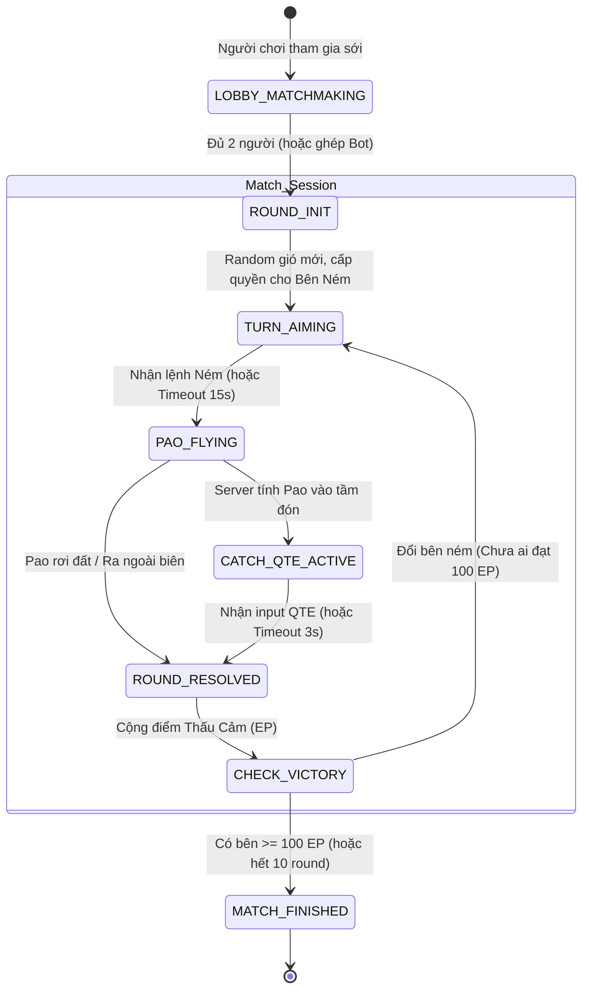

# KIẾN TRÚC KỸ THUẬT HỆ THỐNG (TECH ARCHITECTURE)
## DỰ ÁN: PAO VERSION 0.1 – WEB GAME PWA ĐỐI KHÁNG TỌA ĐỘ
### Next.js + Phaser.js 3 + WebSocket (Socket.io) + Leaflet LBS

---

## 1. TỔNG QUAN KIẾN TRÚC TỔNG THỂ (SYSTEM OVERVIEW)

Dự án được tổ chức theo mô hình **Monorepo** tách biệt giữa Client PWA và Realtime Game Server nhằm tối ưu hóa chi phí vận hành, tính độc lập triển khai và khả năng mở rộng cho solo developer.

```
                              ┌──────────────────────────────────────────────┐
                              │                 CLIENT TẦNG PWA              │
                              │          (Next.js 14+ App Router / TS)       │
                              │                                              │
                              │  ┌──────────────────┐  ┌──────────────────┐  │
                              │  │ Next.js DOM HUD  │  │ Leaflet LBS Map  │  │
                              │  │ (Tailwind UI)    │  │ (Bản đồ Sới Làng)│  │
                              │  └────────┬─────────┘  └────────┬─────────┘  │
                              │           │                     │            │
                              │     Phaser-React Event Bus      │            │
                              │           │                     │            │
                              │  ┌────────▼─────────────────────▼─────────┐  │
                              │  │         Phaser.js 3 Canvas             │  │
                              │  │ (Arcade Physics, Sprites, VFX Đông Hồ) │  │
                              │  └──────────────────┬─────────────────────┘  │
                              └─────────────────────┼────────────────────────┘
                                                    │
                                      WSS (Socket.io) / HTTPS
                                                    │
                                                    ▼
                              ┌──────────────────────────────────────────────┐
                              │            REALTIME GAME SERVER              │
                              │           (Node.js + Socket.io)              │
                              │                                              │
                              │  ┌──────────────────┐  ┌──────────────────┐  │
                              │  │ Matchmaking &    │  │ Match Session    │  │
                              │  │ Geohash Rooms    │  │ State Machine    │  │
                              │  └────────┬─────────┘  └────────┬─────────┘  │
                              │           │                     │            │
                              │  ┌────────▼─────────────────────▼─────────┐  │
                              │  │ Server-Authoritative Physics & Score   │  │
                              │  │ (Kiểm tra Quỹ đạo, Tính điểm Thấu Cảm) │  │
                              │  └──────────────────┬─────────────────────┘  │
                              └─────────────────────┼────────────────────────┘
                                                    │
                                                    ▼
                                      ┌───────────────────────────┐
                                      │ In-Memory Match State +   │
                                      │ SQLite / Local Storage    │
                                      └───────────────────────────┘
```

### 1.1. Phân bổ Công nghệ
- **Client App (`apps/web`):**
  - Framework: Next.js 14+ (App Router, TypeScript, React 18/19).
  - Styling: Tailwind CSS + CSS Custom Properties (Tokens màu ngũ sắc Đông Hồ).
  - Game Engine: Phaser.js 3 (Arcade Physics, Canvas 2D renderer).
  - Bản đồ & LBS: Leaflet.js + React-Leaflet + W3C Geolocation API.
  - PWA: `next-pwa` hoặc `@ducanh2912/next-pwa` (Workbox Service Worker).
  - Triển khai: Vercel / Cloudflare Pages.
- **Server App (`apps/server`):**
  - Runtime: Node.js (v20+) + TypeScript.
  - Framework: Fastify hoặc Express.js.
  - Realtime: Socket.io v4.
  - Triển khai: Railway / Render / Fly.io (Container persistent WebSocket).
- **Gói Dùng Chung (`packages/shared`):**
  - TypeScript types, hằng số vật lý (Physics Constants), gói tin WebSocket Schemas, Game Formulas.

---

## 2. KIẾN TRÚC PHÍA CLIENT (`apps/web`)

### 2.1. Mô hình Phân Lớp Hybrid (Hybrid Layering Architecture)
Để đạt chất lượng đồ họa sắc nét trên màn hình Retina di động và trải nghiệm cảm ứng mượt mà, client phân chia thành 3 tầng Z-index:

```
┌─────────────────────────────────────────────────────────────┐
│ TẦNG 3: Modals & Overlays (Z-index: 50)                      │
│ - Leaflet LBS Sới Làng Popup                                │
│ - Bảng Cài đặt âm thanh, Túi Pao, Hướng dẫn văn hóa         │
├─────────────────────────────────────────────────────────────┤
│ TẦNG 2: Next.js DOM HUD (Z-index: 20, pointer-events: none) │
│ - Thanh Điểm Thấu Cảm (0-100 EP) của 2 bên                  │
│ - Bảng Gió (Wind Vector Arrow & Value)                      │
│ - Thước đo góc rẻ quạt (Interactive pointer-events: auto)   │
│ - Thanh đo lực ném & Nút NÉM triện đỏ                       │
│ - Nút Bắt QTE nhịp điệu (Hiển thị khi bóng tới)             │
├─────────────────────────────────────────────────────────────┤
│ TẦNG 1: Phaser.js 3 Canvas (Z-index: 0)                     │
│ - Nền giấy điệp ánh kim (Shader/Texture)                    │
│ - Bối cảnh Cổng Làng, Cây Đa, Sóng Thủy Ba Đông Hồ          │
│ - Sprite Animation 2 chú bé Đông Hồ (Ném / Đón / Thất vọng) │
│ - Quả Pao Arcade Physics Body + Particle Trail ngũ sắc      │
└─────────────────────────────────────────────────────────────┘
```

### 2.2. Cơ chế Cầu nối Phaser-React (Event Bus Bridge)
Do Phaser 3 hoạt động theo chu kỳ `update()` vòng lặp game, còn Next.js/React hoạt động theo State re-render, ta sử dụng **EventBus (Singleton EventEmitter)** làm cầu nối hai chiều:

```typescript
// packages/shared/src/events/EventBus.ts
export type GameEvent =
  | 'PHASER_READY'
  | 'START_AIMING'
  | 'POWER_CHANGED'
  | 'ANGLE_CHANGED'
  | 'TRIGGER_THROW'
  | 'PAO_IN_FLIGHT'
  | 'TRIGGER_CATCH_QTE'
  | 'CATCH_RESULT'
  | 'WIND_UPDATED'
  | 'EMPATHY_POINTS_UPDATED';

class GameEventBus extends EventTarget {
  emit<T>(event: GameEvent, detail?: T) {
    this.dispatchEvent(new CustomEvent(event, { detail }));
  }

  on<T>(event: GameEvent, callback: (detail: T) => void) {
    const handler = (e: Event) => callback((e as CustomEvent<T>).detail);
    this.addEventListener(event, handler);
    return () => this.removeEventListener(event, handler);
  }
}

export const eventBus = new GameEventBus();
```

- **Từ React sang Phaser:**
  - Người chơi kéo thước đo góc trên DOM -> `eventBus.emit('ANGLE_CHANGED', { angle })` -> Phaser xoay cánh tay ném của nhân vật.
  - Người chơi nhả nút Ném trên DOM -> `eventBus.emit('TRIGGER_THROW', { angle, power, itemId })` -> Phaser kích hoạt hàm `throwPao()`.
- **Từ Phaser sang React:**
  - Quả Pao bay vào tầm đón -> `eventBus.emit('TRIGGER_CATCH_QTE', { durationMs })` -> React hiển thị vòng tròn QTE trên ngực nhân vật đón.
  - Quả Pao va chạm hoặc kết thúc lượt -> `eventBus.emit('ROUND_FINISHED', result)` -> React cập nhật HUD và âm thanh.

### 2.3. Khóa Màn Hình Ngang & Responsive PWA Shell
- Trò chơi được thiết kế tối ưu trên tỉ lệ **16:9 đến 20:9 Landscape**.
- **CSS Orientation Guard:**
  ```css
  /* Khi người dùng cầm dọc điện thoại */
  @media screen and (orientation: portrait) {
    #orientation-warning {
      display: flex !important;
    }
    #game-container {
      display: none !important;
    }
  }
  ```
- Hiển thị màn hình hướng dẫn xoay ngang điện thoại kèm tranh minh họa bé Đông Hồ nghiêng người.

---

## 3. KIẾN TRÚC PHÍA SERVER (`apps/server`)

### 3.1. Mô hình Server-Authoritative State Machine
Để đảm bảo tính công bằng và tránh cheat góc/lực/điểm số, Server nắm giữ toàn bộ trạng thái và kết quả của trận đấu. Client chỉ là cơ chế hiển thị (Render View) và gửi Input.



### 3.2. Thuật toán Vật lý & Kiểm định Quỹ Đạo (Trajectory Validation)
Server tính toán quỹ đạo chuyển động ném xiên để xác định thời điểm và tọa độ va chạm:

$$\begin{cases}
x(t) = x_0 + (v_0 \cos\alpha + k_{wind} \cdot W) \cdot t \\
y(t) = y_0 + (v_0 \sin\alpha) \cdot t - \frac{1}{2} g \cdot t^2
\end{cases}$$

Trong đó:
- $v_0$: Vận tốc ban đầu được chuyển đổi từ thanh lực $[0, 100] \to [0, 25 \text{ m/s}]$.
- $\alpha$: Góc ném $[0^\circ, 90^\circ]$.
- $g$: Gia tốc trọng trường chuẩn hóa ($9.8 \text{ m/s}^2$ hoặc thông số arcade scaling của Phaser).
- $W$: Vectơ gió $[-5.0, +5.0]$.
- $k_{wind}$: Hệ số cản gió của loại quả Pao đang trang bị.

Server kiểm tra xem tại thời điểm $t_{hit}$ khi $y(t) \approx y_{target}$, khoảng cách $|x(t) - x_{target}|$ có nằm trong phạm vi đón $R_{catch}$ hay không:
- Nếu $|x(t_{hit}) - x_{target}| \le R_{catch}$: Gửi tín hiệu kích hoạt QTE sang máy đối thủ kèm timestamp chính xác.
- Nếu ngoài phạm vi: Kết luận ném trượt (Miss / Ground hit).

---

## 4. ĐẶC TẢ GÓI TIN WEBSOCKET (SOCKET.IO SPECIFICATIONS)

Toàn bộ payload được định kiểu chặt chẽ (Strongly Typed) trong `packages/shared`.

### 4.1. Nhóm Gói Tin Client -> Server (C2S)

```typescript
// packages/shared/src/types/socket-events.ts

export interface C2S_JoinMatchPayload {
  userId: string;
  userName: string;
  soiId: string;           // ID của Sới Làng LBS
  paoType: string;         // 'pao_vai_lanh' | 'pao_ngo_nuong' | ...
  equippedItems: string[]; // Tối đa 2 item thổ cẩm
  isPracticeWithBot?: boolean;
}

export interface C2S_ThrowPaoPayload {
  matchId: string;
  angle: number;           // 0 -> 90
  power: number;           // 0 -> 100
  activeItemId?: string;   // Item sử dụng trong lượt này (nếu có)
  clientTimestamp: number;
}

export interface C2S_CatchQTEInputPayload {
  matchId: string;
  pressOffsetMs: number;   // Độ lệch thời gian so với tâm chuẩn (<0: bấm sớm, >0: bấm trễ)
  clientTimestamp: number;
}

export interface C2S_EmojiReactPayload {
  matchId: string;
  emojiId: 'cuoi_hoa' | 'chuc_mung' | 'tiec_nuoi' | 'moi_tra';
}
```

### 4.2. Nhóm Gói Tin Server -> Client (S2C)

```typescript
export interface S2C_MatchFoundPayload {
  matchId: string;
  opponent: {
    userId: string;
    userName: string;
    avatar: string;
    paoType: string;
    isBot: boolean;
  };
  fieldConfig: {
    soiName: string;
    distancePx: number;   // Khoảng cách giữa 2 nhân vật
    bgTexture: string;    // 'bg_dinh_lang' | 'bg_dong_ho'
  };
}

export interface S2C_RoundStartPayload {
  roundNumber: number;
  throwerId: string;       // ID người được quyền ném
  catcherId: string;       // ID người đón
  wind: {
    speed: number;         // 0.0 -> 5.0
    direction: 'left' | 'right';
  };
  turnDurationMs: number;  // 15000 (15s)
}

export interface S2C_PaoThrownPayload {
  throwerId: string;
  angle: number;
  power: number;
  paoType: string;
  activeItem?: string;
  trajectory: {
    durationMs: number;
    willReachCatcher: boolean;
    apexPoint: { x: number; y: number };
  };
}

export interface S2C_TriggerQTEPromptPayload {
  catcherId: string;
  qteWindowMs: number;     // Thời gian cửa sổ QTE hiển thị (ví dụ 1200ms)
  targetTimestamp: number; // Mốc thời gian hoàn hảo (Epoch time)
}

export interface S2C_RoundResultPayload {
  roundNumber: number;
  paoLanded: boolean;
  qteGrade: 'PERFECT' | 'GOOD' | 'MISS' | 'NONE';
  empathyGained: {
    throwerGained: number;
    catcherGained: number;
  };
  totalEmpathy: {
    [userId: string]: number; // Điểm tích lũy hiện tại (0 -> 100)
  };
  flavorMessage: string;      // Ví dụ: "Một cú bắt tuyệt mỹ giữa nhịp hội xuân!"
}

export interface S2C_MatchEndPayload {
  winnerId: string | null;   // null nếu hòa duyên
  finalEmpathy: { [userId: string]: number };
  reward: {
    exp: number;
    unlockedItem?: string;
    soiBadge?: string;
  };
}
```

---

## 5. DỮ LIỆU & LƯU TRỮ (DATA MODELS & PERSISTENCE)

Trong giai đoạn v0.1, hệ thống ưu tiên lưu trữ nhẹ, client dùng `IndexedDB / LocalStorage` cho dữ liệu offline PWA, server dùng in-memory cache cho room states.

### 5.1. Cấu trúc Mô hình Người chơi (Player Profile)
```typescript
export interface PlayerProfile {
  id: string;
  name: string;
  avatarId: string;           // 'be_trai_dong_ho' | 'be_gai_dong_ho'
  title: string;              // 'Nghệ nhân Sới Đình'
  level: number;
  unlockedPaos: string[];
  inventoryItems: {
    itemId: string;
    quantity: number;
  }[];
  stats: {
    totalMatches: number;
    victories: number;
    perfectCatches: number;
    highestStreak: number;
  };
}
```

### 5.2. Cấu trúc Sới Làng LBS (Arena POI Model)
```typescript
export interface SoiVillagePOI {
  id: string;
  name: string;               // "Sới Cây Đa Làng Đông Hồ"
  geohash: string;            // "w4rqpe"
  lat: number;
  lng: number;
  culturalDescription: string;
  weatherModifier: {
    baseWindSpeed: number;
    windDirectionTrend: 'random' | 'east' | 'west';
  };
  bonusEmpathyRate: number;   // 1.0 -> 1.2
}
```

---

## 6. THUẬT TOÁN TRÍ TUỆ NHÂN TẠO SOLO BOT (AI BÉ ĐÔNG HỒ)

Để người chơi luôn có trải nghiệm mượt mà khi không có đối thủ online hoặc kiểm thử offline:
1. **Tính toán Góc/Lực Lý Thuyết (Inverse Kinematics):**
   Bot tính lực cơ bản $v_{base}$ cần thiết dựa trên khoảng cách $D$ và góc mặc định $\alpha = 45^\circ$:
   $$v_{base} = \sqrt{\frac{g \cdot D}{\sin(2\alpha)}}$$
   Sau đó bù trừ hệ số gió $W$ và thuộc tính quả pao.
2. **Hệ số Nhiễu Gaussian (Human-like Error):**
   Bot không ném chuẩn 100% như máy móc, mà áp dụng độ lệch chuẩn phân phối chuẩn Gauss:
   $$\alpha_{bot} = \alpha_{calc} + \mathcal{N}(0, \sigma_{\alpha})$$
   $$v_{bot} = v_{calc} + \mathcal{N}(0, \sigma_{v})$$
   - Mức độ Dễ: $\sigma_{\alpha} = 6^\circ$, tỷ lệ bắt QTE Perfect $30\%$, Good $50\%$, Miss $20\%$.
   - Mức độ Khéo léo: $\sigma_{\alpha} = 2^\circ$, tỷ lệ bắt QTE Perfect $65\%$, Good $30\%$, Miss $5\%$.

---

## 7. CHIẾN LƯỢC NGOẠI TUYẾN & PWA (OFFLINE & SERVICE WORKER)

1. **Chiến Lược Caching Của Workbox:**
   - **Static Assets (HTML, JS, CSS, Font Thư Pháp):** *Cache-First* với TTL 30 ngày.
   - **Game Textures & Spritesheets (Đông Hồ 2D):** *Stale-While-Revalidate*, nén định dạng WebP lossless.
   - **Audio Clips (Khèn, Sáo, Trống, SFX):** *Cache-First*, nén AAC/MP3 64-96kbps tối ưu băng thông.
2. **Khả năng Chơi Offline:**
   - Khi mất kết nối Internet, PWA vẫn tải toàn bộ màn hình sới làng và kích hoạt chế độ **"Đấu Tập Cùng Bé Đông Hồ (Offline Mode)"** hoàn toàn trên Client mà không cần gọi đến Server WebSocket.
